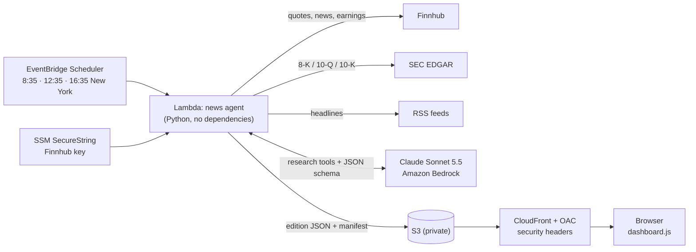

# AI Stock News Dashboard

A news dashboard for US large-cap stocks, written by an AI agent and hosted on AWS. Three times per trading day (pre-market, midday, after the close), a Lambda function:

1. collects prices, company news, market news, earnings dates, SEC filings and RSS headlines,
2. lets **Claude Sonnet 5.5 on Amazon Bedrock** research (with tools) and write the edition as schema-validated JSON,
3. checks every citation against the collected items and asks the model to fix anything that fails,
4. publishes the edition to a private S3 bucket served by CloudFront.

The page layout and the "the LLM writes data, a fixed renderer draws it" approach come from the *Tablero de Inteligencia Ejecutiva* (`pwa-dashboards-ppl/frontend/public/tablero-ceo`). The Grupo Salinas content, sources and rules were replaced with a stock-market edition. The pipeline is new: an automated Bedrock agent instead of a manual Cowork session.

| Section | Content |
|---|---|
| Indicator strip | S&P 500, Nasdaq 100, Dow, Russell 2000, Treasuries, gold, oil, dollar (through ETFs) |
| 01 Top of the day | What happened · Key alert · Market mover |
| 02 Latest news | 4–10 stories grouped by theme (macro, earnings, AI & tech, deals, policy, company) |
| 03 Your watchlist | One card per ticker: price, news-flow tone, summary, what to watch, headlines, next earnings |
| 04 Markets | Watchlist movers, sector ETFs, upcoming earnings |
| 05 Sectors | Tabs with sector ETF performance and sector stories |
| 06 Radar | Catalysts, risks and data to watch, plus how the edition was made |

## Architecture



**How the agent stays factual**

- Every collected article or filing gets an ID (`E001`, `E002`, …). The model sees IDs, headlines and short summaries; it never sees or writes URLs. Code fills in the links, sources and timestamps from the collected data, so the page cannot show a made-up link.
- Prices and percentage moves come from market data, not from the model.
- The edition is generated with Bedrock **structured outputs** (JSON schema), and the research tools use **strict tool use**.
- `validate.py` then checks the result: unknown IDs, stories without evidence from the news window, a story repeated across sections, missing watchlist tickers, and a mover without a quote. Safe problems are fixed automatically. The rest are sent back to the model for up to two repair rounds.
- If Bedrock fails (access, throttling, timeout), the run still publishes a **fallback edition**: market data plus source headlines, clearly labeled.
- Feed text is treated as untrusted data (prompt-injection rule in the system prompt), and the renderer escapes everything under a strict Content-Security-Policy.

## Project layout

```
agent/stocknews/        Lambda package (stdlib + the boto3 bundled with the Lambda runtime)
  config/watchlist.json   watchlist, indicator strip, sectors, RSS feeds, limits   <- edit this
  collect.py finnhub.py sec.py rss.py   data collection
  evidence.py           evidence pool (IDs, dedupe, news window)
  agent.py llm.py tools.py prompts.py schema.py   Bedrock agent (research -> write -> repair)
  validate.py compose.py publish.py pipeline.py handler.py
  demo.py local_run.py  offline demo and local runs
web/                    static site (index.html, assets/dashboard.js, assets/dashboard.css)
template.yaml           AWS SAM / CloudFormation stack
samconfig.toml          deploy defaults
scripts/deploy.ps1|.sh  deploy stack + upload site (+ optional first run)
tests/                  pytest suite (fake Bedrock/Finnhub) and renderer tests (node)
.github/workflows/      CI tests + optional deploy through GitHub OIDC
run_local.py            python run_local.py --demo | --live
```

## 1. Try it locally (no keys needed)

```powershell
python run_local.py --demo --slot close
python -m http.server 8000 --directory web
# open http://localhost:8000
```

The demo edition is synthetic placeholder content (every headline starts with `[Demo]`, links go to example.com, and a banner says so). It exists only to preview the layout.

## 2. Deploy to AWS

Prerequisites: AWS CLI v2 and AWS SAM CLI, signed in to your account (`aws configure` or SSO). The steps below use `us-east-1`. Any region where the Claude inference profile is available works.

1. **Enable Claude on Bedrock (one time per account).** In the Bedrock console, open the model catalog, pick **Claude Sonnet 5.5** and open it in the playground. The first time, Bedrock asks for Anthropic's short use-case form. Send one test prompt; that also creates the AWS Marketplace subscription, so the Lambda role only needs `bedrock:InvokeModel`.
2. **Get a free Finnhub API key** at finnhub.io and store it in Parameter Store:
   ```powershell
   aws ssm put-parameter --region us-east-1 --type SecureString `
     --name /stock-news-dashboard/finnhub-api-key --value "YOUR_FINNHUB_KEY"
   ```
3. **Deploy** (first time guided; it saves your answers to `samconfig.toml`):
   ```powershell
   .\scripts\deploy.ps1 -Guided
   ```
   Set `SecUserAgent` to something like `Your Name you@example.com` to enable SEC filings (the SEC requires a contact header). Set `AlarmEmail` to get emailed if a run fails, then confirm the SNS email.
4. **Publish the first edition now** instead of waiting for the schedule:
   ```powershell
   .\scripts\deploy.ps1 -RunNow
   ```
   After 2–5 minutes, open the `Dashboard:` URL printed by the script (a `*.cloudfront.net` address).

Bash users: `./scripts/deploy.sh --guided`, then `./scripts/deploy.sh --run-now`.

No `sam build` step is needed: the function has no third-party packages, so `sam deploy` uploads `agent/` as is.

### Stack parameters

| Parameter | Default | Notes |
|---|---|---|
| `ModelId` | `global.anthropic.claude-sonnet-5-5` | Bedrock inference profile. `us.anthropic.claude-sonnet-5-5` keeps processing in US regions. `global.anthropic.claude-haiku-5-5` is much cheaper. |
| `Effort` | `medium` | Claude effort level (`low`…`max`, or `none` for the model default). |
| `Language` | `en` | `es` writes the edition and labels in Spanish. |
| `Watchlist` | empty | Comma-separated tickers that replace the configured watchlist, e.g. `AAPL,MSFT,NVDA,AMD`. |
| `ScheduleExpression` | `cron(35 8,12,16 ? * MON-FRI *)` | Evaluated in `ScheduleTimezone` (`America/New_York`, so DST is handled). In US winter that is 7:35, 11:35 and 15:35 in Mexico City. |
| `ScheduleState` | `ENABLED` | `DISABLED` pauses the agent (and its costs). |
| `SecUserAgent` | empty | Enables SEC EDGAR filings. |
| `AlarmEmail` | empty | Creates alarms for Lambda errors and fallback editions. |

Change the watchlist, strip, sectors or feeds in `agent/stocknews/config/watchlist.json` and redeploy. Tickers outside the configured list work too: unknown names fall back to the symbol, and you can add `name`, `sector` and `aliases` for better matching.

## 3. Run the real pipeline on your machine

```powershell
$env:FINNHUB_API_KEY = "YOUR_FINNHUB_KEY"
$env:SEC_USER_AGENT  = "Your Name you@example.com"   # optional
$env:AWS_PROFILE     = "default"                     # credentials with bedrock:InvokeModel
python run_local.py --live            # writes web/data, then preview with http.server
python run_local.py --live --no-llm   # test the collectors without calling Bedrock
```

Other environment variables: `MODEL_ID`, `BEDROCK_REGION`, `EFFORT`, `LANGUAGE`, `WATCHLIST`, `RESEARCH_TOOLS`, `MAX_TOOL_CALLS`, `MAX_REPAIRS`, `PRICE_INPUT_MTOK` and `PRICE_OUTPUT_MTOK` (used for the cost estimate). Local runs need `pip install boto3`; the tests need `pip install -r requirements-dev.txt`.

## Costs (estimate)

- **Bedrock** is the main cost. With Claude Sonnet 5.5 at Anthropic's list price of $2 / $10 per million input/output tokens, one edition uses roughly 30–60K input tokens (mostly cached) and 8–15K output tokens. That is about **$0.15–0.30 per edition**, or **$10–20 a month** at 3 editions per trading day. Haiku 5.5 costs a fraction of that. Bedrock rates can differ by endpoint (global vs. geo profiles), so check the Bedrock pricing page. Each run logs its token use and an estimated cost (also published as CloudWatch metrics).
- **Lambda, S3, CloudFront, EventBridge Scheduler, Parameter Store:** typically within the free tiers for a personal dashboard (a few cents a month for logs at most).
- **Finnhub:** free plan (about 60 calls/minute). A run makes about 45 calls.

## Operations

- **Logs:** CloudWatch log group `/aws/lambda/<stack>-news-agent` (30-day retention).
- **Metrics:** namespace `StockNewsDashboard`: `FallbackEdition`, `DegradedEdition`, `EvidenceItems`, `InputTokens`, `OutputTokens`, `EstimatedCostUsd`, `RunSeconds`.
- **Re-run an edition (bash):** `aws lambda invoke --function-name <stack>-news-agent --invocation-type Event --cli-binary-format raw-in-base64-out --payload '{"slot":"close"}' out.json`. The same edition ID is replaced and the history is kept.
- **History:** the last 120 editions stay in the timeline (`data/manifest.json`). Older edition files remain in S3.
- **Pause:** redeploy with `ScheduleState=DISABLED`.
- **Remove:** `sam delete --stack-name stock-news-dashboard`. The site bucket is retained on purpose; empty it and delete it if you no longer need the history.

### Optional CI/CD (GitHub Actions)

`.github/workflows/ci-deploy.yml` runs the tests on every push and pull request. To deploy `main` automatically, create an IAM role for GitHub OIDC that can deploy this stack, then set the repository variable `AWS_DEPLOY_ROLE_ARN`. Optional variables: `AWS_REGION`, `STACK_NAME`, and `RUNNER_LABEL` (for example `self-hosted`). The deploy job uses `aws-actions/setup-sam`, which needs a Linux x86_64 runner.

## Security notes

- The S3 bucket is private, with public access blocked. Only CloudFront can read it (Origin Access Control), and only over TLS.
- CloudFront sends a strict Content-Security-Policy (no inline scripts or styles), HSTS, `nosniff`, `DENY` framing and a referrer policy. `index.html` carries the same CSP as a meta tag, so local previews enforce it too.
- The renderer HTML-escapes all data and only links `http(s)` URLs, with `rel="noopener noreferrer"`.
- The Finnhub key lives in SSM Parameter Store (SecureString) and is sent as a header, never in URLs or logs.
- The Lambda role can only invoke the configured model, read (and decrypt through SSM) that one parameter, list the site bucket and read/write objects under `data/`.
- The dashboard is public to anyone with the CloudFront URL. To restrict it, add CloudFront signed cookies, Cognito, or a WAF IP allow list.

## Data and usage terms

- Finnhub's free plan is for personal, non-commercial use. Making the dashboard public for an organization or a business needs a paid plan.
- News content belongs to its publishers. The dashboard shows headlines, short AI-written summaries and links to the original articles. Review each source's terms before redistributing at scale.
- AI summaries can contain mistakes. The page says so and links every story to its source. Nothing here is investment advice.

## Tests

```powershell
pip install -r requirements-dev.txt
python -m pytest
node --test tests/web/renderer.test.mjs
```

The Python suite drives the whole pipeline with a scripted fake Bedrock client (tool calls, validation failures, repair rounds, feature downgrades, fallback editions) and fake market data. No network or AWS credentials are needed.
