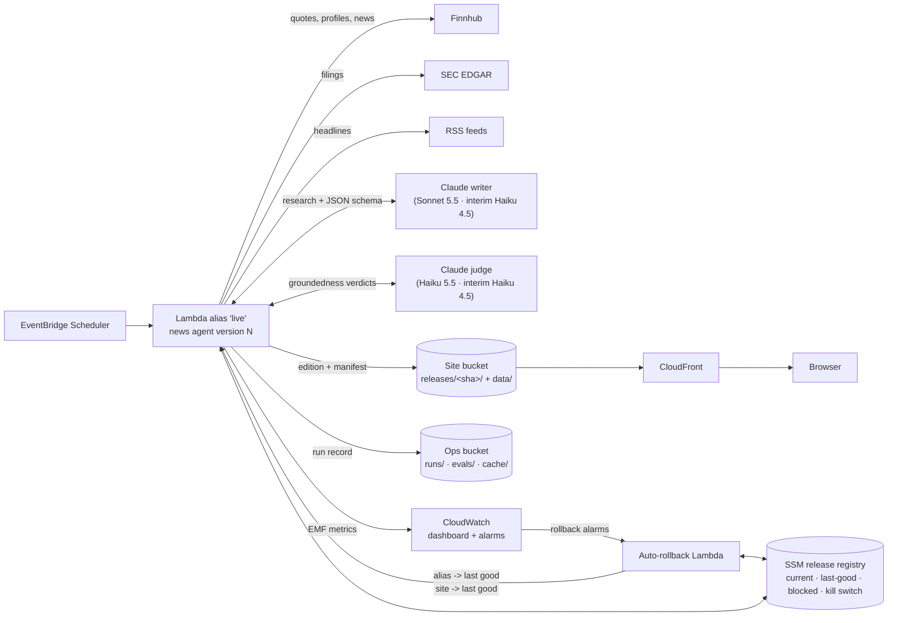

# AI Stock News Dashboard

A news dashboard for the **20 largest S&P 500 companies**, written by an AI agent and run on AWS with LLMOps controls: offline evals before every release, an online quality gate before every edition, operational and quality metrics with alarms, and a fast, automatic rollback to the last validated release.

Three times per trading day (pre-market, midday, after the close) a Lambda function:

1. ranks the S&P 500 top 20 by market cap and collects their prices, company news, SEC filings, market news, earnings dates and RSS headlines,
2. lets **Claude on Amazon Bedrock** research (with tools) and write the edition as schema-validated JSON (Claude Sonnet 5.5 in the target setup; see [Models](#models-profiles-access-and-switching-back)),
3. validates every citation, then runs the **quality gate**: deterministic checks (figures against market data, advice language) and an **LLM judge** (Claude Haiku 5.5 in the target setup) that scores each section's groundedness against its cited evidence,
4. publishes what passes to a private S3 bucket behind CloudFront (sections that fail are replaced by source headlines), and writes a **run record** that can be replayed as an eval case.

| Section | Content |
|---|---|
| Indicator strip | S&P 500, Nasdaq 100, Dow, Russell 2000, Treasuries, gold, oil, dollar (through ETFs) |
| 01 Top of the day | Three cards about top-20 companies only (What happened · Key alert · Market mover) and the **top-20 board**: rank, price, change, market cap and a one-line AI note with its source |
| 02 Latest news | 4–10 stories grouped by theme (macro, earnings, AI & tech, deals, policy, company) |
| 03 Your watchlist | Watchlist tickers **outside** the top 20 (the page is left out when there are none) |
| 04 Markets | Biggest moves among the top 20 and your watchlist, sector ETFs, upcoming earnings |
| 05 Sectors | Tabs with sector ETF performance and sector stories |
| 06 Radar | Catalysts, risks and data to watch, plus how the edition was made and its quality scores |

The top 20 is recomputed every run from Finnhub company profiles (market cap) over a pool of about 40 mega-caps in `agent/stocknews/config/watchlist.json` (`universe.pool`); Alphabet counts once (GOOGL). Index constituents are a paid Finnhub feature, so keep the pool a little larger than 20.

## Architecture



Releases flow through GitHub Actions: **test → package once → eval gate (real models) → dev → production (approval)**. Inside each CloudFormation deployment, a CodeDeploy **PreTraffic hook** runs a smoke edition on the new Lambda version before the `live` alias moves to it. A release then **bakes** in production; after N good editions it becomes the **last good** release, the rollback target. Details, metrics and runbooks: **[docs/llmops.md](docs/llmops.md)**.

### Where the fast rollback lives

Every release is a **Lambda version** (immutable: code, prompts, schema, config and model ids together) plus a **site release** under `releases/<git-sha>/` in the site bucket. Production serves whatever the `live` alias and the root `index.html` point to, and the **release registry** in SSM Parameter Store (`/stock-news-dashboard/prod/release/last-good`) records the last validated pair. Rolling back is moving two pointers, which takes seconds:

- **Automatic:** while a release bakes, the `-rb-` alarms (agent errors, fallback edition, quality gate withheld, low groundedness) trigger the auto-rollback Lambda, which restores the last good version and site, blocks the bad release and emails you.
- **One click:** GitHub → Actions → **operate** → `rollback` (also from the GitHub mobile app), or `python scripts/release.py rollback --env prod --reason "..."`.
- **Without a deployment:** the AI **kill switch** (`operate` → `ai-off`) publishes data-and-headlines editions until you turn it back on, and `withdraw` removes a bad edition from the page.

## How the agent stays factual

- Every collected article or filing gets an ID (`E001`, …). The model sees IDs, headlines and short summaries; it never sees or writes URLs. Code fills in links, sources and timestamps, so the page cannot show a made-up link.
- Prices, % moves and market caps come from market data. The deterministic checks flag any figure in the AI text that matches neither the quotes of the companies mentioned nor the cited evidence.
- Bedrock **structured outputs** (JSON schema) and **strict tool use**; the top-20 tickers are schema enums, so the model cannot put a non-top-20 company in "Top of the day".
- `validate.py` fixes what is safe (unknown IDs, duplicates, over-long text) and sends the rest back for up to two repair rounds (missing top-20 notes, top cards not about the top 20, stories without fresh evidence…).
- The **quality gate** withholds sections the judge rates unsupported, sections with unverified figures or advice language, and the whole AI text when groundedness falls under the floor. The page then shows source headlines in their place and says so.
- If Bedrock fails, the run still publishes a clearly labeled **fallback edition** (market data + headlines). Feed text is treated as untrusted data, and the renderer escapes everything under a strict Content-Security-Policy.

## Project layout

```
agent/stocknews/          Lambda package (stdlib + the boto3 bundled with the runtime)
  config/watchlist.json     top-20 pool, watchlist, strip, sectors, RSS feeds, limits   <- edit this
  collect.py finnhub.py sec.py rss.py market.py   collection and the top-20 ranking
  agent.py llm.py tools.py prompts.py schema.py validate.py   Bedrock agent (research -> write -> repair)
  quality.py                deterministic checks and the runtime quality gate
  evals/                    LLM judge, datasets (seed + captured runs), metrics, eval runner, thresholds.json
  runrecord.py registry.py ops.py   run records, release registry, smoke hook, rollback
  compose.py publish.py pipeline.py handler.py demo.py local_run.py
web/                      static site (index.html, assets/dashboard.js, assets/dashboard.css)
template.yaml             app stack (one per environment): site, agent, smoke hook, rollback, alarms, dashboard
infra/bootstrap.yaml      one-time account setup: GitHub OIDC roles, CloudFormation role, buckets, budget
infra/params/dev.json     per-environment parameters (prod.json for production)
scripts/deploy.py         bootstrap | package | app | site | release | run | validate
scripts/release.py        status | rollback | kill-switch | withdraw | capture | history | ...
.github/workflows/        ci, evals, release (CD), operate (incident actions)
docs/llmops.md            LLMOps design, metrics, alarms and runbooks
tests/                    pytest suite (fake Bedrock/Finnhub/AWS) and renderer tests (node)
```

## 1. Try it locally (no keys needed)

```powershell
python run_local.py --demo --slot close
python -m http.server 8000 --directory web
# open http://localhost:8000
```

The demo edition is synthetic placeholder content (headlines start with `[Demo]`, links go to example.com, and a banner says so).

## 2. Deploy to AWS

Prerequisites: Python 3.10+ (`pip install -r requirements-dev.txt`), the AWS SAM CLI and credentials for your account. The steps use `us-east-1`.

1. **Check model access.** `python scripts/deploy.py check-models --env prod` sends one tiny request to the models of the environment's model profile and explains any problem (see [Models](#models-profiles-access-and-switching-back)). The repository currently deploys the interim `haiku-4-5` profile.
2. **Store your Finnhub key** (free at finnhub.io):
   ```powershell
   aws ssm put-parameter --region us-east-1 --type SecureString `
     --name /stock-news-dashboard/finnhub-api-key --value "YOUR_FINNHUB_KEY"
   ```
3. **Bootstrap the account** (GitHub OIDC roles, CloudFormation execution role, artifacts and ops buckets, monthly budget). Add `--create-oidc-provider` if the account has no GitHub OIDC provider yet:
   ```powershell
   python scripts/deploy.py bootstrap --github-repo Cesarho96/stock-news-dashboard --email you@example.com --create-oidc-provider
   ```
4. **Deploy.** Through GitHub (recommended, see section 3), or from your machine:
   ```powershell
   $env:ALARM_EMAIL = "you@example.com"; $env:SEC_USER_AGENT = "Your Name you@example.com"
   python scripts/deploy.py release --env dev     # package + stack + site
   python scripts/deploy.py run --env dev         # publish an edition now
   ```
   Confirm the SNS subscription email. `scripts/deploy.ps1 -Env dev -RunNow` does the same from PowerShell.

The first deployment creates the stack directly; every later deployment goes through the CodeDeploy smoke gate.

### Stack parameters (`infra/params/<env>.json`)

| Parameter | prod | Notes |
|---|---|---|
| `ModelProfile` | `haiku-4-5` | Writer and judge models, effort, thinking and prices from `infra/models.json` (`target` = Sonnet 5.5 + Haiku 5.5). |
| `JudgeEnabled` | `true` | LLM judge used by the quality gate. |
| `QualityFloor` / `QualityTarget` | `0.6` / `0.8` | Groundedness under the floor withholds all AI text; under the target the edition is marked degraded. |
| `BakeEditions` | `3` | Good editions before a release becomes the rollback target (dev: 1). |
| `SmokeTest` / `AutoRollback` | `ENABLED` | Deployment smoke gate and automatic rollback during the bake. |
| `Effort`, `Language`, `Watchlist` | `medium`, `en`, empty | As before (`Language=es` writes in Spanish). |
| `ScheduleExpression` | `cron(35 8,12,16 ? * MON-FRI *)` | New York time (dev: once a day after the close). |
| `DailyCostAlarmUsd`, `MinEvidenceItems` | `3`, `40` | Cost and data-source alarms. |

`AlarmEmail` and `SecUserAgent` come from the `ALARM_EMAIL` / `SEC_USER_AGENT` environment variables (GitHub variables in CI). A change to any parameter is a release like any other: it goes through the eval gate, the smoke test and the bake. `python scripts/deploy.py validate` checks every params file and model profile against the template.

## Models: profiles, access and switching back

`infra/models.json` holds named **model profiles**; each `infra/params/<env>.json` picks one with `"ModelProfile"`. The deploy script, the eval runner (CI) and `check-models` all read the same profile, so what is evaluated is what gets deployed.

| Profile | Writer | Judge | Notes |
|---|---|---|---|
| `target` | Claude Sonnet 5.5 (effort medium, adaptive thinking) | Claude Haiku 5.5 | the intended setup |
| `haiku-4-5` (**active now**) | Claude Haiku 4.5 (no effort parameter, thinking off) | Claude Haiku 4.5 | interim, while the account only has Haiku 4.5; about half the cost; the same model grades its own work, so read groundedness as optimistic |

**Getting access to the other models.** Bedrock enables serverless models automatically: the first call to a model subscribes the account through AWS Marketplace. That first call must come from an identity with `aws-marketplace:Subscribe`, `aws-marketplace:Unsubscribe` and `aws-marketplace:ViewSubscriptions` (an administrator has them), and it can take up to 2 minutes. Anthropic's one-time use-case form applies to older models such as Claude Haiku 4.5, so your account has already done it. To try:

1. Bedrock console (us-east-1) > **Model catalog** > Claude Sonnet 5.5 > **Open in playground**, send one prompt; same for Claude Haiku 5.5. Or run `python scripts/deploy.py check-models --env prod --model-profile target` with administrator credentials.
2. If it still answers *access denied*, access to that model is restricted for your account; for that case the Bedrock documentation says to contact AWS Sales (or your AWS account team). If it answers *throttling*, ask for a higher tokens-per-minute quota in **Service Quotas**.

**Switching back to `target`** once `check-models --model-profile target` passes:

1. Optional preview of the quality: `cd agent; python -m stocknews.evals --params ../infra/params/prod.json --model-profile target --dataset seed: --gate gate`.
2. On a branch, set `"ModelProfile": "target"` in `infra/params/dev.json` and `infra/params/prod.json`, open a PR (the evals run with the new models), merge. The release pipeline deploys it through the smoke test and the bake; if it misbehaves, the automatic rollback returns to the Haiku 4.5 release.

## 3. CI/CD with GitHub Actions

| Workflow | When | What |
|---|---|---|
| `ci` | every PR and branch push | ruff, pytest, renderer tests, cfn-lint + SAM transform check |
| `evals` | PRs touching `agent/stocknews/**`, Mondays, manual | real-model evals on the seed and golden datasets; fails on the gate |
| `release` | push to `main` | test → package → eval gate → dev → production (approval) |
| `operate` | manual | status, rollback, AI kill switch, withdraw an edition, run an edition |

Setup (once): run the bootstrap (section 2), then in the repository settings:

1. **Variables:** `AWS_ROLE_ARN` (bootstrap output `DeployRoleArn`), `AWS_EVALS_ROLE_ARN` (`EvalsRoleArn`), `OPS_BUCKET` (`OpsBucketName`), and optionally `AWS_REGION`, `ALARM_EMAIL`, `SEC_USER_AGENT`, `RUNNER_LABEL` (e.g. `self-hosted`), `EVALS_MAX_CASES`.
2. **Environments:** create `dev` and `production`; on `production` add yourself as a required reviewer (and optionally restrict it to the `main` branch).
3. **Branch protection on `main`:** require the `ci` check (and `evals` if you want the eval gate on every PR).

Work on a branch, open a PR (ci + evals run), merge, approve the production deployment.

## 4. Run the real pipeline and the evals on your machine

```powershell
$env:FINNHUB_API_KEY = "YOUR_FINNHUB_KEY"
$env:AWS_PROFILE     = "default"                 # credentials with bedrock:InvokeModel
python run_local.py --live                       # writes web/data and a run record in .runs/
python run_local.py --live --no-llm              # collectors only
cd agent
python -m stocknews.evals --params ../infra/params/prod.json --dataset seed: --dataset ../.runs/runs/ --gate gate
```

The eval report prints as Markdown (groundedness, validity, unverified figures, coverage, cost, latency per case).

## Costs (estimate)

- **Bedrock:** one edition is about 30–60K input tokens (mostly cached) and 8–15K output tokens for the writer, about $0.15–0.30 with Sonnet 5.5 at list price, plus about $0.01–0.03 for the Haiku judge. The interim `haiku-4-5` profile ($1 / $5 per million tokens) costs roughly half. Three editions per trading day ≈ **$10–20/month** in prod; dev adds about $4/month; each deployment smoke test and eval run costs about the same as one edition per case. Check the Bedrock pricing page for your endpoint. Every run logs and publishes its estimated cost.
- **Lambda, S3, CloudFront, Scheduler, Parameter Store, CodeDeploy:** typically within the free tiers. CloudWatch custom metrics (about 25 per environment) and alarms cost a few dollars a month.
- **Finnhub:** free plan (about 60 calls/minute); a run makes about 90 calls, plus 40 profile calls once a day.

## Security notes

- CI uses **GitHub OIDC** (no stored AWS keys). The deploy role can only hand a scoped CloudFormation execution role to CloudFormation, write release artifacts, and operate the app's functions, registry and site; production deployments need an environment approval. The evals role can only call Bedrock and read eval data.
- The site bucket is private (CloudFront Origin Access Control, TLS only, versioned). CloudFront sends a strict Content-Security-Policy, HSTS, `nosniff`, `DENY` framing and a referrer policy; the renderer escapes all data and only links `http(s)` URLs.
- The Finnhub key lives in SSM Parameter Store (SecureString) and is sent as a header. The agent's role can only invoke the configured writer and judge models.
- Run records and eval datasets contain third-party news text; they stay in the private ops bucket and are not committed to git.

## Data and usage terms

- Finnhub's free plan is for personal, non-commercial use; a public or business dashboard needs a paid plan.
- News content belongs to its publishers. The dashboard shows headlines, short AI-written summaries and links to the original articles.
- AI summaries can contain mistakes. The page says so, links every story to its source and publishes its quality scores. Nothing here is investment advice.

## Tests

```powershell
pip install -r requirements-dev.txt
ruff check agent tests scripts
python -m pytest
node --test tests/web/renderer.test.mjs
python scripts/deploy.py validate
```

The Python suite drives the whole pipeline with scripted fakes for Bedrock (writer and judge), Finnhub and AWS: tool calls, repair rounds, the quality gate (withheld sections, data-only editions), eval gates and regressions, run-record replay, the release registry bake, the smoke hook and both rollback paths. No network or AWS credentials needed.
