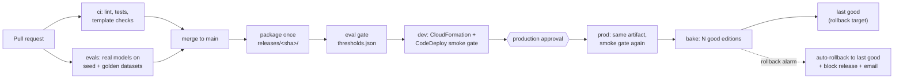

# LLMOps: evals, metrics, corrective actions and rollback

This document describes how the AI stock news dashboard is released, measured and operated: what is evaluated before a release, what is checked before every edition, which metrics and alarms watch production, what to do when one fires, and how to get back to the last validated state fast.

## 1. Release lifecycle



A **release** is one git commit SHA. It consists of:

| Part | Where | Immutable? |
|---|---|---|
| Agent code, prompts (`PROMPT_VERSION` + fingerprint), JSON schema, validator, quality gate, `watchlist.json` | Lambda **version** (published by SAM `AutoPublishAlias`) | yes |
| Writer and judge model ids, effort, language, quality thresholds | the same Lambda version (environment variables) | yes |
| Site (index.html, JS, CSS) | `releases/<sha>/` in the site bucket | yes |
| Packaged template + code zip + site bundle | `s3://<artifacts>/releases/<sha>/` | yes (built once, deployed to dev and prod) |
| Infrastructure | CloudFormation stack `stock-news-dashboard-<env>` | CloudFormation rolls back failed updates |

Because prompts, schema and model ids live inside the Lambda version, "the model behaved differently" and "the code changed" are versioned and rolled back together.

## 2. Where the fast rollback lives

**The rollback point is a pair of pointers, recorded in the release registry:**

- the Lambda alias **`live`** (the schedule invokes the alias, never `$LATEST`), and
- the root **`index.html`** of the site bucket, which loads `releases/<sha>/assets/…`.

The **release registry** in SSM Parameter Store keeps the validated pair:

| Parameter | Content |
|---|---|
| `/stock-news-dashboard/<env>/release/current` | live release: `releaseId`, `functionVersion`, `state` (`baking` / `validated`), good/bad edition counters |
| `/stock-news-dashboard/<env>/release/last-good` | the last release that finished its bake: `releaseId`, `functionVersion`, `siteRelease` |
| `/stock-news-dashboard/<env>/release/site-current` | the site release behind `index.html` |
| `/stock-news-dashboard/<env>/release/blocked` | releases that were rolled back; CI refuses to deploy them again |
| `/stock-news-dashboard/<env>/ai-enabled` | the AI kill switch (`true` / `false`) |

SSM keeps the full history of each parameter (`python scripts/release.py history --env prod`), which is the audit trail of deployments, promotions and rollbacks.

**Ways back, fastest first:**

| Situation | Action | How | Time |
|---|---|---|---|
| A new release misbehaves while baking | automatic rollback | `-rb-` alarm → auto-rollback Lambda moves `live` and `index.html` to last good, blocks the release, emails you, publishes a fresh edition | ~1 minute after the alarm |
| Anything else, any time | manual rollback | GitHub **operate** → `rollback` (empty target = last good), or `python scripts/release.py rollback --env prod --reason "..."` | seconds |
| Roll back to an older release | targeted rollback | `--to-release <sha>` (finds the Lambda version by its description `release <sha>`) | seconds |
| The model or a provider misbehaves, not a release | kill switch | **operate** → `ai-off` (editions publish market data and headlines only); `ai-on` to restore | next edition, no deployment |
| One bad edition is on the page | withdraw | **operate** → `withdraw` with the edition id; readers see the previous edition | seconds |
| A deployment fails | nothing to do | the smoke gate keeps the old version live; CloudFormation rolls the stack back | automatic |
| A manifest or page file was overwritten | S3 versioning | restore the previous object version (30 days of versions are kept) | minutes |

After a rollback, **fix forward**: revert or fix on a branch; the PR runs the evals and the release pipeline redeploys. The rolled-back SHA stays blocked (`release.py unblock` if you really need it).

## 3. Evals (before a release)

### Datasets

| Dataset | Source | Purpose |
|---|---|---|
| `seed:` | `agent/stocknews/evals/seed.py`: one synthetic after-the-close session with stories, quotes, earnings and a filing that agree with each other | always available, deterministic inputs; also the deployment smoke test |
| `golden` | `s3://<ops>/evals/datasets/golden/`: production **run records** copied with `python scripts/release.py capture --env prod --latest 3` | real news mixes (earnings days, macro days, quiet days, outages) |
| any run record | `s3://<ops>/runs/<env>/<date>/` or `.runs/` locally | replay any edition with a candidate prompt or model |

Every scheduled run writes a run record with its **frozen inputs** (market snapshot + evidence pool + timing), so building the golden set is a copy, not a labeling project. Research-tool results are recorded too and served again during replay. Keep the golden set small and varied (10–20 cases); add a case whenever an incident teaches you something.

### Metrics per case

| Metric | Meaning |
|---|---|
| `schemaValid`, `firstPassValid`, `finalValid` | the model returned parseable JSON / passed validation on the first draft / after repairs |
| `groundedness` | LLM judge: mean of 1 (supported), 0.5 (partially supported), 0 (unsupported) over all sections |
| `unsupported`, `partial` | sections the judge could not fully back with the cited evidence |
| `unverifiedNumbers` | % moves, prices or $ figures that match neither market data nor the cited evidence |
| `adviceFlags` | buy/sell/hold language aimed at the reader |
| `citationErrors` | evidence ids the model invented |
| `top20Coverage` | share of top-20 rows with a validated AI note |
| `withheld`, `gate` | sections the quality gate removed; publish / degrade / withhold |
| `costUsd`, `seconds`, tokens, `repairs`, `toolCalls` | efficiency |

### The gate (`agent/stocknews/evals/thresholds.json`)

`gate` (CI, before deploying) requires, across all cases: final validity 100%, first-pass validity ≥ 50%, mean groundedness ≥ 0.85 and worst case ≥ 0.65, every case judged, top-20 coverage ≥ 95%, ≤ 1 unverified figure per edition, no advice language, ≤ 5% invented citations, no withheld editions, mean cost ≤ $0.75 and p95 latency ≤ 10 minutes. **Regression checks** compare with the eval report of the last good release (maximum drop: 0.05 in groundedness, 0.05 in top-20 coverage, 0.34 in first-pass validity). With `JudgeEnabled=false` the judge checks are skipped and the gate relies on the deterministic checks. `smoke` is the reduced set the deployment hook applies to the seed edition.

The thresholds are code: changing them is a reviewed PR. Run the suite locally:

```bash
cd agent
python -m stocknews.evals --params ../infra/params/prod.json --dataset seed: --dataset s3://<ops>/evals/datasets/golden/ --gate gate --summary report.md
```

### The LLM judge

`evals/judge.py` sends each section (top cards, top-20 notes, stories, watchlist notes, sector stories) to Claude Haiku 5.5 with only the evidence it cites and the market data for the companies it mentions, and asks for a verdict per section with the unsupported details quoted. The judge sees no URLs and no outside context, uses a fixed JSON schema (`JUDGE_VERSION` is recorded), and is itself tested with scripted answers. Judge drift is watched by the weekly eval run on a fixed golden set: a sudden change in groundedness with unchanged code points at the models behind the inference profiles.

## 4. The quality gate (before every edition)

After the writer's JSON passes validation, `pipeline.produce()` runs the deterministic checks and the judge, then `quality.decide()`:

| Finding | Decision | Corrective action applied automatically |
|---|---|---|
| advice language in the headline or summary | **withhold** | data-and-headlines edition (no AI text) |
| judge groundedness < `QualityFloor` (0.6) | **withhold** | data-and-headlines edition |
| a section with advice language, an unverified figure, or an `unsupported` verdict | **degrade** | that section is removed; its slot shows the source headline (top cards, board rows) or disappears (stories) |
| groundedness < `QualityTarget` (0.8), or validation issues left after 2 repairs | **degrade** | edition published with a "partially validated" banner |
| judge unavailable | publish | rules-only check; `JudgeError` metric and alarm |
| otherwise | **publish** | — |

The "How this edition was made" box on the Radar page shows the groundedness, the judge model, unverified figures and withheld sections, so readers see the quality of what they read.

## 5. Operational metrics, dashboard and alarms

Each edition emits one CloudWatch Embedded Metric Format line (namespace `StockNewsDashboard`, dimensions `Service`, `Environment`) that also carries the edition id, release, gate decision, model and prompt version for Logs Insights.

| Group | Metrics |
|---|---|
| Outcomes | `EditionPublished`, `FallbackEdition`, `DegradedEdition`, `WithheldByGate`, `SectionsWithheld`, `AiSkipped` |
| Quality | `Groundedness`, `UnsupportedSections`, `UnverifiedNumbers`, `CitationErrors`, `AdviceFlags`, `FirstPassValid`, `Top20Coverage`, `JudgeError` |
| Cost and effort | `EstimatedCostUsd` (writer + judge), `InputTokens`, `OutputTokens`, `RepairRounds`, `ToolCalls` |
| Latency and data | `RunSeconds`, `LlmSeconds`, `EvidenceItems`, `SourceErrors` |

**Dashboard:** CloudWatch → Dashboards → `stock-news-dashboard-<env>-llmops` (outcomes, quality, hallucination signals, cost, latency, sources, alarm status, latest editions). **Saved queries** (Logs Insights): `<stack>/editions`, `<stack>/quality-by-release`, `<stack>/ai-failures`.

**Alarms** (all email the SNS topic):

| Alarm | Fires when | During the bake | Afterwards |
|---|---|---|---|
| `-rb-agent-errors` | a scheduled run (alias `live`) failed | **auto-rollback** | notify |
| `-rb-fallback-edition` | an edition had no AI text because the AI step failed | **auto-rollback** | notify |
| `-rb-quality-withheld` | the gate withheld all AI text | **auto-rollback** | notify |
| `-rb-low-groundedness` | average groundedness < target in two consecutive 6-hour windows | **auto-rollback** | notify |
| `-degraded-editions` | ≥ 2 degraded editions in a day | notify | notify |
| `-unverified-figures` | ≥ 5 unverified figures in a day | notify | notify |
| `-judge-errors` | the judge failed twice in a day | notify | notify |
| `-daily-cost` | estimated spend of a day > `DailyCostAlarmUsd` | notify | notify |
| `-low-evidence` | an edition collected < `MinEvidenceItems` items | notify | notify |
| `-slow-runs` | a run took > 13 minutes | notify | notify |
| `-auto-rollback-errors` | the rollback function failed | notify (roll back by hand) | notify |

Outside the bake window a rollback alarm only notifies: a validated release that starts failing usually means data, a provider or the model changed, and rolling back code would not help. Use the runbook below.

## 6. Runbook (corrective actions)

Start with `python scripts/release.py status --env prod` (or **operate** → `status`): live version, registry, recent editions and firing alarms.

**Rollback alarm during a bake (you got a "rolled back to …" email).** Production is already on the last good release and a fresh edition is being published. Find the cause with the `<stack>/ai-failures` query and the run records under `s3://<ops>/runs/prod/<date>/`; replay the failing run with `python -m stocknews.evals --dataset s3://<ops>/runs/prod/<date>/<file>`; fix on a branch, add the run record to the golden set (`release.py capture --edition <id>`), merge.

**Fallback editions (AI step failed) on a validated release.** Check the reason on the page footer or in `<stack>/ai-failures`: `AccessDeniedException` (model access or IAM), `ThrottlingException` / timeouts (Bedrock capacity: switch `ModelId` to another inference profile in `infra/params/prod.json` and release), `ValidationException` (a request feature was rejected; the client already retries without it, check the `Bedrock features disabled` note). If the model output itself is the problem, turn the **kill switch** off while you investigate.

**Low groundedness / withheld sections.** Open the quality section of the run record (`quality.judge.problems`, `quality.checks.unverified`): unsupported causes ("rose on…") mean the prompt needs tightening; wrong figures mean the model ignored MARKET DATA. Replay the case against a prompt change locally, then PR (the evals must pass). If it happens on many editions at once with no release, suspect model drift behind the inference profile: run the `evals` workflow on the golden set and compare with the last good report.

**Unverified figures alarm.** Same as above, focused on numbers; check whether a data source changed format (e.g. prices in summaries).

**Judge errors.** Rules-only checks keep running. Check Haiku model access and quotas; the release pipeline will not pass the eval gate until the judge works again.

**Low evidence / source errors.** A feed or Finnhub is failing (the edition lists source errors in its QA block). Finnhub limits: 60 calls/minute on the free plan. Editions keep publishing with what is available.

**Cost alarm.** Look at `InputTokens` / `RepairRounds` / `ToolCalls` on the dashboard. Repair loops and tool storms are the usual causes; lower `MAX_TOOL_CALLS`, `Effort`, or move the writer to a cheaper model (through a release, so the evals check the quality).

**A bad edition is visible.** **operate** → `withdraw` (edition id from the page URL `?edition=…` or `status`), then rollback or kill switch as appropriate.

## 7. Preventive strategies

- **Eval gate on every change that touches the agent** (PR workflow) and before every deployment (release workflow), with regression checks against the last good release.
- **Same artifact in dev and prod** (build once), and production behind an approval.
- **Smoke test inside the deployment:** the new Lambda version writes the seed edition with the real models before the alias moves; a failure keeps the old version live.
- **Bake before trust:** a release only becomes the rollback target after N good production editions.
- **Blocked releases:** a rolled-back SHA cannot be redeployed by accident.
- **Constrained generation:** JSON schema with top-20 enums, strict tools, citation-only evidence, validator + repair rounds, deterministic figure checks, LLM judge, advice filter.
- **Weekly drift evals** on a fixed golden set, and a growing golden set built from real incidents.
- **Traceability:** every edition records release, model ids, prompt version and fingerprint; every run record can be replayed.
- **Cost guardrails:** per-run cost estimate, daily cost alarm, monthly AWS Budget, `MaximumRetryAttempts: 0` on scheduled runs.
- **Least privilege:** GitHub OIDC roles, a scoped CloudFormation execution role, and per-function IAM policies.
- **Practice:** run `operate → rollback` and `ai-off`/`ai-on` in dev once, so the steps are familiar before they are needed.
